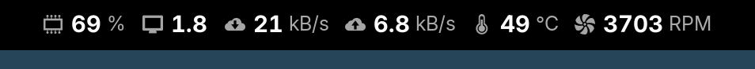
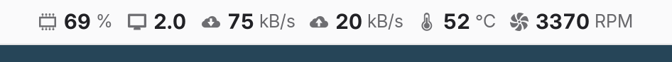

# Screenshots

[Documentation index](../../README.md) · [Using Vitals](../../README.md#using-vitals) · [Updating screenshots](../development.md#screenshots)

[Top bar](#top-bar) · [Menu](#menu) · [Preferences](#preferences)

## Top bar

By default, the top bar shows memory usage, system load and download speed. These screenshots also show upload speed, average temperature and fan speed, unless the caption lists other pins. Battery and GPU monitoring are enabled, and public IP lookup is disabled. Readings come from the machine used for capture.

Default appearance, including **Crop icons**. Cropping removes transparent borders while preserving each icon's proportions.

 

Top Bar › **Emphasize values** disabled. When enabled, icons and units are drawn lighter and smaller than the numbers.

 

Top Bar › **Crop icons** disabled. GNOME gives each icon a square, leaving transparent space around narrow artwork. Menu icons always use this sizing.

 

General › **Icon style** set to Adwaita.

 

Top Bar › **Hide icons** enabled. Menu icons remain visible.

 

General › **Use higher precision** enabled. Battery charge, battery power rate and processor frequency gain a decimal place; uptime includes seconds.

 

Temperature › **Unit** set to °F and Network › **Measure in** set to Bits. The pinned sensors show download and upload speed, total data downloaded and uploaded since boot, and the processor's temperature.

 

**Threshold Colors** defined on the Temperature and Memory pages. A color applies from its threshold value up to the next one.

 

Default appearance with other pins: WiFi signal with its bars, battery charge, screen redraws and free storage.

 

## Menu

Each category header shows its selected reading. One category can be open at a time. Selecting a sensor opens its row menu with actions to pin, rename or hide it. The rest of the menu is dimmed while the row menu is open. See [Using Vitals](../../README.md#using-vitals) for the actions and category ordering.

The network category is shown with Network › **Only show hardware interfaces** enabled, which is the default. It hides bridges, container, VPN and loopback interfaces.

### Categories closed

Light style

### Network category open

Light style

### Sensor actions

Light style

## Preferences

The preferences window, showing the General page.

