# Screenshots

## Top bar

By default, the top bar shows memory usage, system load and download speed. For these screenshots, upload speed, average temperature and fan speed are pinned in addition.

| Setting | Result |
|---|---|
| Default settings | 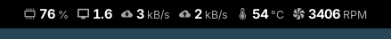 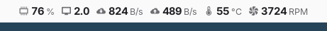 |
| Top Bar › **Emphasize values** disabled. When enabled, icons and units are drawn lighter and smaller than the numbers. | 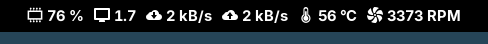 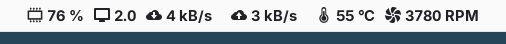 |
| General › **Icon style** set to GNOME. |  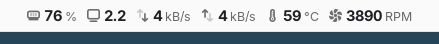 |
| Top Bar › **Hide icons** enabled. The icons in the menu stay. |  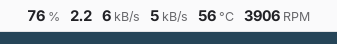 |
| General › **Use higher precision** enabled. Values have one more decimal place, and uptimes include seconds. Shown: battery charge, battery power rate, processor frequency and uptime. |  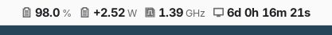 |
| Temperature › **Unit** set to °F and Network › **Measure in** set to Bits. Shown: download and upload speed, downloaded and uploaded since boot, and the processor's temperature. | 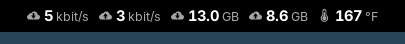 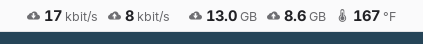 |
| **Threshold Colors** defined on the Temperature and Memory pages. A color applies from its threshold value up to the next one. | 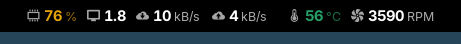 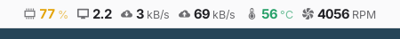 |
| Default settings. Any value in the menu can be pinned to the top bar; shown: the WiFi signal with its bars, battery charge, screen redraws and free storage. | 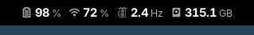 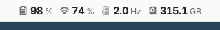 |

## Menu

Each category shows one value in its header. One category can be open at a time. Selecting a row opens its row menu: pin it to the top bar, rename it, hide it, or make it the value the category shows in its header. The rest of the menu is dimmed while the row menu is open.

The network category is shown with Network › **Only show hardware interfaces** enabled, which is the default. It hides bridges, container, VPN and loopback interfaces.

| Categories closed | Network category open | Row menu of a sensor |
|---|---|---|
| 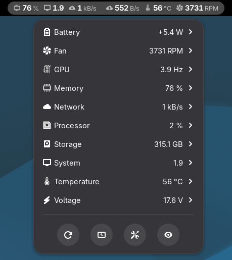 | 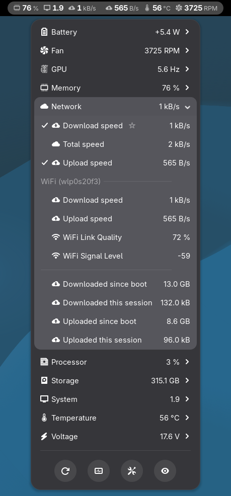 | 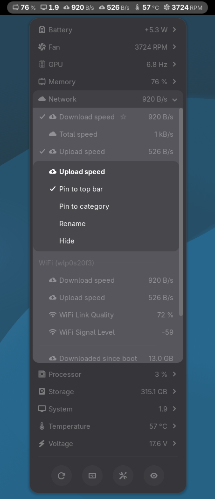 |
| 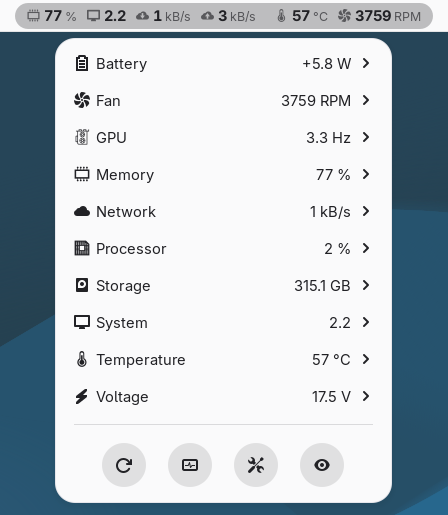 | 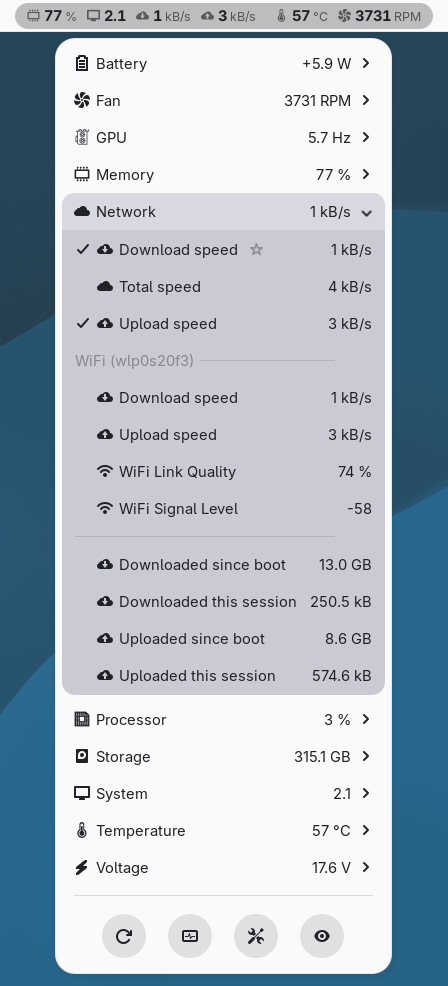 | 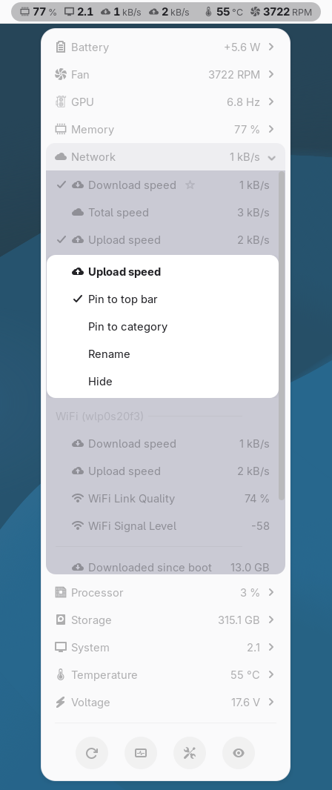 |

The second row shows the same menus in the GNOME light style.

## Preferences

The preferences window, showing the General page.

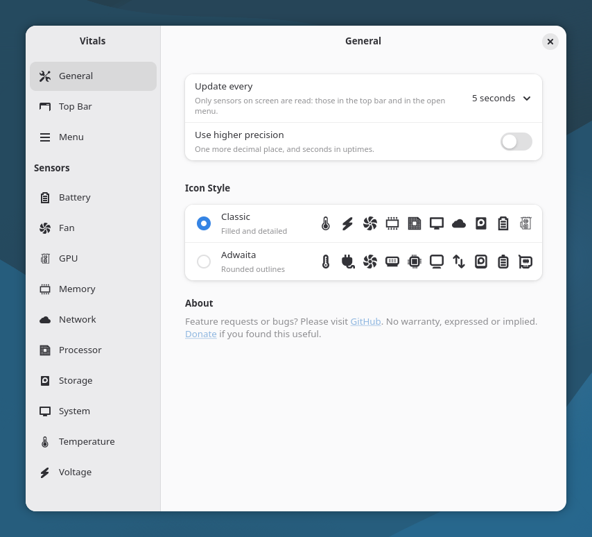
