# Screenshots

[Documentation index](../README.md) · [Updating screenshots](../development.md#screenshots)

[Top bar](#top-bar) · [Menu](#menu) · [Preferences](#preferences)

Captures use UI scale 2 and are displayed smaller here. Click an image to see it at full resolution. The top-bar examples show the button highlighted under the pointer.

## Top bar

Default appearance. Top-bar icons have transparent borders removed while preserving each icon's proportions.

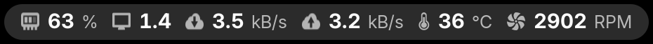 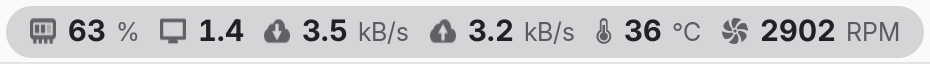

**Top Bar** › **Emphasize values** disabled. When enabled, icons and units are drawn lighter and smaller than the numbers.

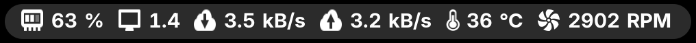 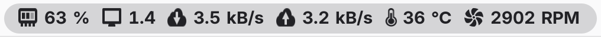

**General** › **Icon style** set to Adwaita.

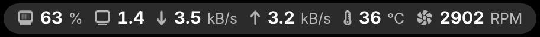 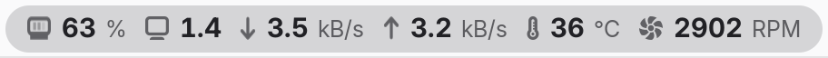

**Top Bar** › **Hide icons** enabled. Menu icons remain visible.

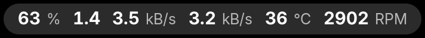 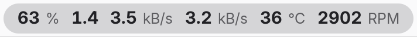

**General** › **Use higher precision** enabled. Battery charge, battery power rate and processor frequency gain a decimal place; uptime includes seconds.

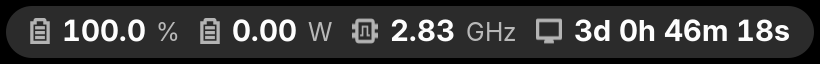 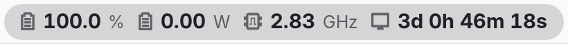

**Temperature** › **Unit** set to °F and **Network** › **Measure in** set to **Bits**. The pinned sensors show download and upload speed, total data downloaded and uploaded since boot, and the processor's temperature.

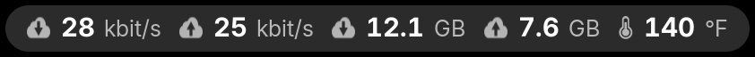 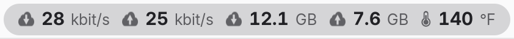

**Threshold Colors** defined on the temperature and memory pages. A color applies from its threshold value up to the next one.

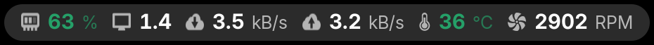 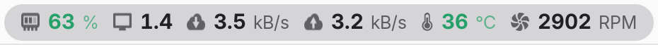

Default appearance with other pins: WiFi signal with its bars, battery charge, screen redraws and free storage.

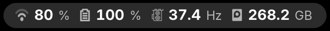 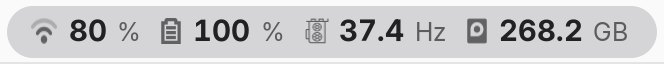

### Dynamic icons

Memory and WiFi icons change with their readings. These examples show memory used and WiFi link quality, with simulated readings for 32 GiB of RAM.

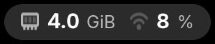 
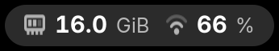 
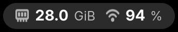

## Menu

Each category header shows its selected reading. One category can be open at a time. Selecting a sensor opens its row menu with actions to pin, rename or hide it. The rest of the menu is dimmed while the row menu is open.

The network category is shown with **Network** › **Only show hardware interfaces** enabled, which is the default. It hides bridges, container, VPN and loopback interfaces.

### Categories closed

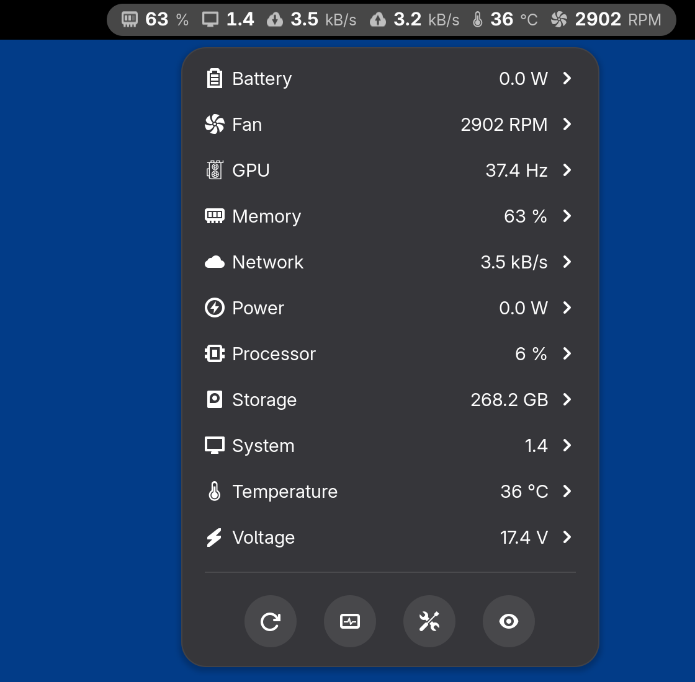

Light style

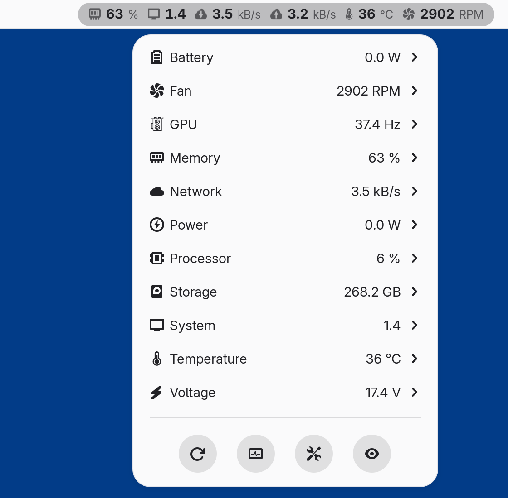

### Network category open

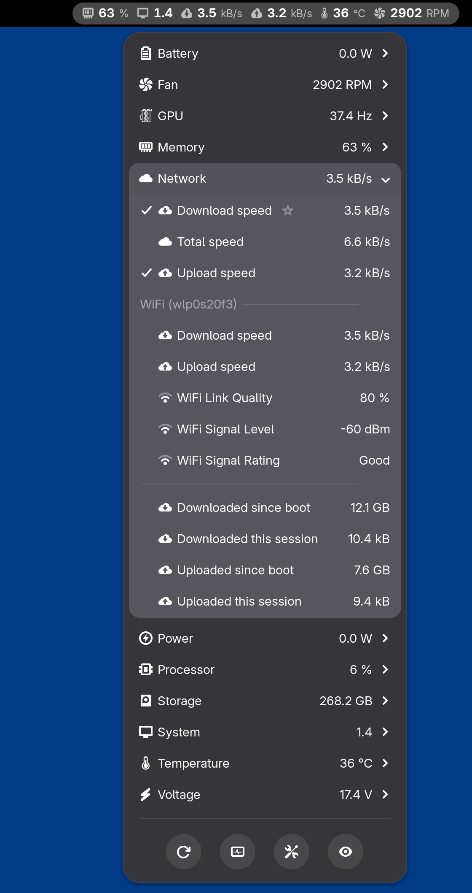

Light style

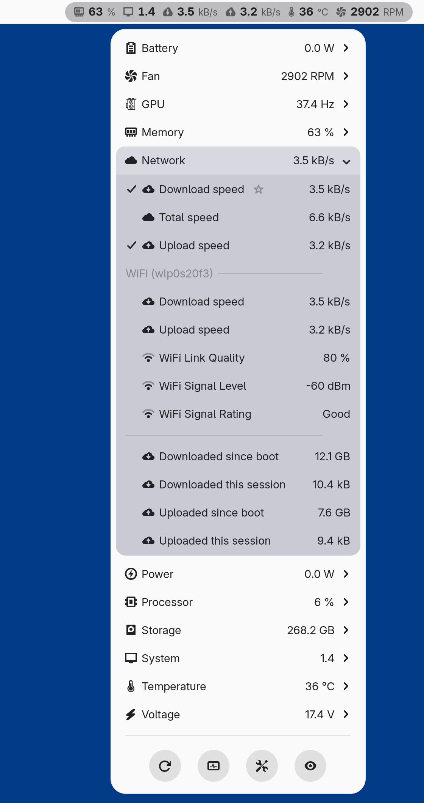

### Sensor actions

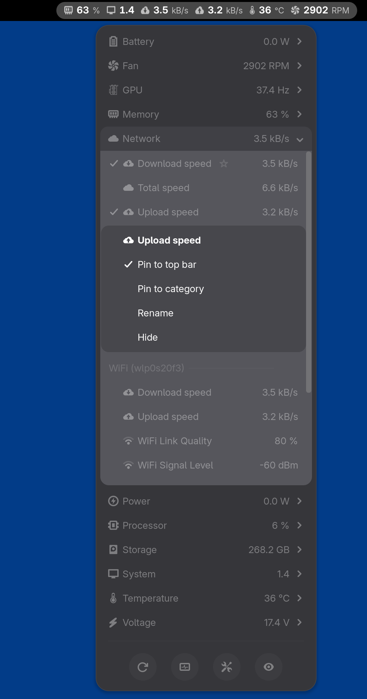

Light style

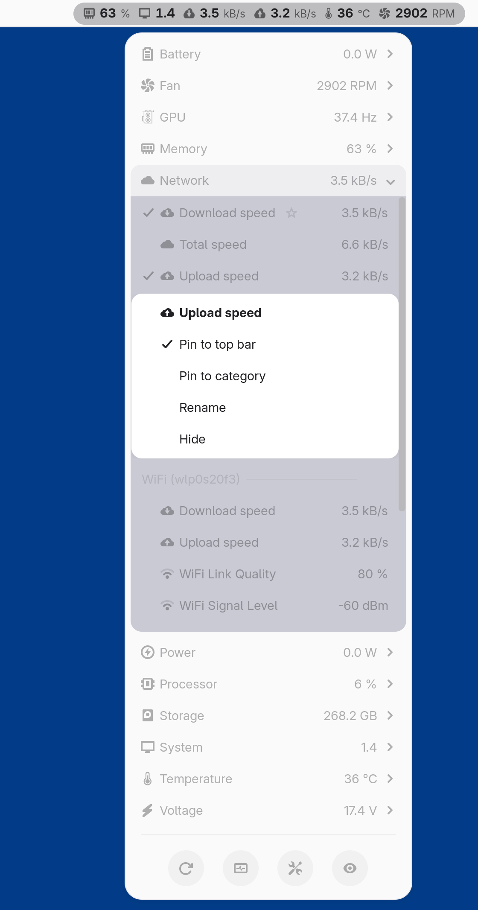

## Preferences

The preferences window, showing the general page.

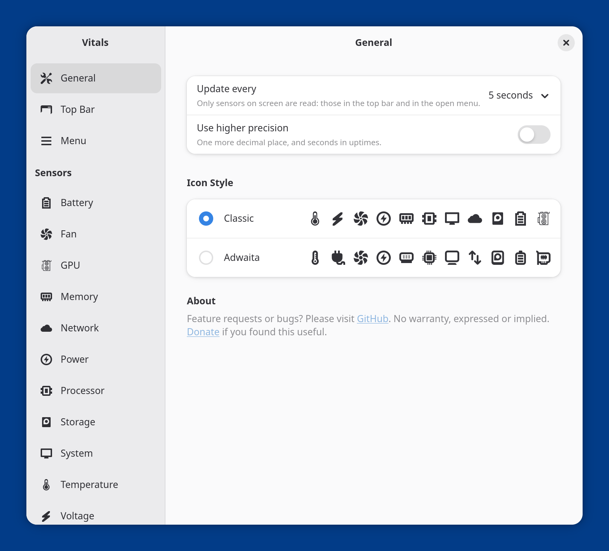
